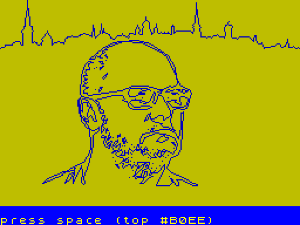

[](http://www.apache.org/licenses/LICENSE-2.0)
[](https://bell-sw.com/pages/downloads/#jdk-25-lts)
[](https://maven.apache.org/)
[](https://search.maven.org/artifact/com.igormaznitsa/j2z80-plugin/2.0.0/jar)   
[](https://www.arthursacresanimalsanctuary.org/donate)

# j2z80

   
[View the ZX Spectrum example source](j2z80-examples/zx-spectrum-hello-world/src/main/java/com/igormaznitsa/test/helloworld/main.java)

Originally developed in 2012 as an academic test project, j2z80 was dormant for years. In 2026, the dust was blown
off: the project was revived, modernized, and released as version 2.0.0 on Maven Central.

j2z80 is a Maven plugin that translates compiled Java bytecode into native Z80 code. It produces a 64 KB program image
that can run on a Z80 machine or emulator; it does not include a JVM or bytecode interpreter. The entry point is
`public static void mainz()`.

## Quick start

Let's imagine that you want just fill whole ZX-Spectrum screen by the same value as its low address byte, then your
program may look like the snippet.

```java
import j2z80.ZSystem;

public class FillScreen {
  public static void mainz() {
    for(int a = 0x4000; a < 0x5800; a++) {
      ZSystem.poke(a, (byte)a);
    }
    ZSystem.halt();
  }
}
```

Add the API as a `provided` dependency and configure the plugin in your Maven project. The `install` phase runs
translation and writes the selected output formats under the project's build directory.

```xml
    <dependencies>
        <dependency>
            <groupId>com.igormaznitsa</groupId>
            <artifactId>j2z80-api</artifactId>
            <version>2.0.0</version>
            <scope>provided</scope>
        </dependency>
    </dependencies>

    <build>
        <plugins>
            <plugin>
                <groupId>com.igormaznitsa</groupId>
                <artifactId>j2z80-plugin</artifactId>
                <version>2.0.0</version>
                <executions>
                    <execution>
                        <id>translate-z80</id>
                        <phase>package</phase>
                        <goals>
                            <goal>translate</goal>
                        </goals>
                        <configuration>
                            <optimization>COMPACT</optimization>
                            <formats>
                                <format>A80</format>
                                <format>BIN</format>
                                <format>SNA</format>
                            </formats>
                            <excludeResources>
                                <value>/**/*.xml</value>
                                <value>/**/*.properties</value>
                                <value>/**/*.mf</value>
                            </excludeResources>
                        </configuration>
                    </execution>
                </executions>
            </plugin>
        </plugins>
    </build>
```

## What it supports

- Classes, fields, constructors, virtual/interface calls, casts, `instanceof`, arrays, switches, and checked
  `try`/`catch`/`finally`.
- Records and enums, with the limitations below.
- `float` (binary16), `long` (signed 32-bit), and `double` (binary32).
- JNI methods implemented in embedded Z80 assembly.
- ZX Spectrum 48K snapshots and APIs for screen, keyboard, and sound.

## Important limits

- Values use 16-bit slots and the address space is 64 KB; Java numeric widths and precision are not generally preserved.
- The standard Java library is not available. `String` methods, lambdas, and method references are unsupported.
- Only checked exceptions are supported. Field and array access have no null or bounds checks.
- The heap has no garbage collector or allocation-failure check. `ZSystem.forget` rewinds to an ordinary object and
  releases it and later allocations; arrays are not valid rewind targets.
- `long[][]` and `double[][]` are unsupported. Record `toString()` returns `null`; enum `name()` and `valueOf` are
  unsupported.

See the [translation model and limitations](docs/translation.md) for details.

## Documentation

- [Maven plugin setup and parameters](docs/plugin.md)
- [Output formats and configuration](docs/configuration.txt)
- [Supported Java types and runtime behavior](docs/translation.md)
- [Embedded assembler reference](docs/asm.md)
- [JNI guide](docs/jni.md)
